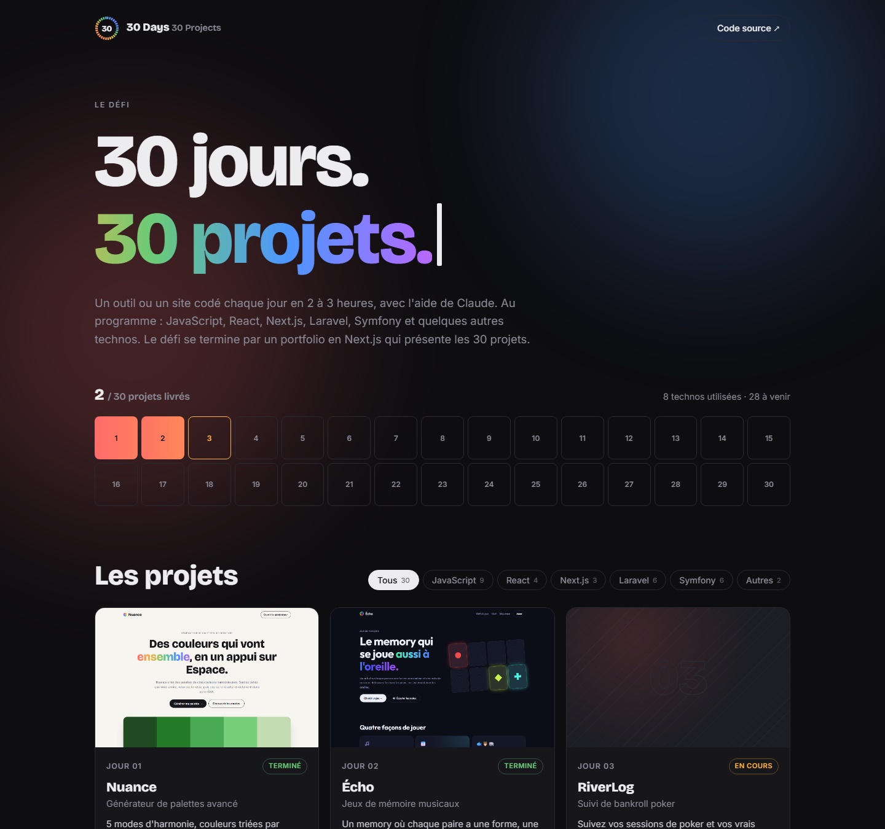

# 30 Days, 30 Projects · Site vitrine

🌐 **[projectp.fr](https://projectp.fr/)**

La page d'accueil du défi **30 jours, 30 projets** : un outil ou un site codé chaque jour en 2 à 3 heures, avec l'aide de Claude.

Elle présente la progression du défi (calendrier des 30 jours) et une carte par projet, avec sa capture d'écran, ses technos et son lien.

Chaque projet a **son propre dépôt GitHub** et sa propre adresse en ligne : voir les colonnes « Démo » et « Code » ci-dessous.

[](https://projectp.fr/)

## Les 30 projets

| Jour | Projet | Techno | Statut | Démo | Code |
|:---:|---|---|:---:|:---:|:---:|
| 01 | **Nuance** · Générateur de palettes avancé | JavaScript · CSS | ✅ | [🔗](https://nuance.projectp.fr/) | [GitHub](https://github.com/PierreWZK/Nuance) |
| 02 | **Écho** · Jeux de mémoire musicaux | React · Vite · Web Audio | ✅ | [🔗](https://echo.projectp.fr/) | [GitHub](https://github.com/PierreWZK/Echo) |
| 03 | **RiverLog** · Suivi de bankroll poker | Laravel · MySQL · Chart.js | ✅ | [🔗](https://riverlog.projectp.fr/) | [GitHub](https://github.com/PierreWZK/RiverLog) |
| 04 | **3logy** · Hub geek (dev + jeux + ciné) | JavaScript · API RAWG · API TMDB | ✅ | [🔗](https://3logy.projectp.fr/) | [GitHub](https://github.com/PierreWZK/3logy) |
| 05 | **Kairos** · Réservation de créneaux | Symfony · EasyAdmin · MySQL | ✅ | [🔗](https://kairos.projectp.fr/) | [GitHub](https://github.com/PierreWZK/Kairos) |
| 06 | **Sursaut** · Jeu de réflexes | JavaScript · CSS · Web Audio | ✅ | [🔗](https://sursaut.projectp.fr/) | [GitHub](https://github.com/PierreWZK/Sursaut) |
| 07 | **Pécule** · Dashboard de dépenses | React · Recharts · PocketBase | ✅ | [🔗](https://pecule.projectp.fr/) | [GitHub](https://github.com/PierreWZK/Pecule) |
| 08 | Raccourcisseur d'URL avec statistiques | Laravel | ⏳ | — | — |
| 09 | Comparateur de voitures | Symfony | ⏳ | — | — |
| 10 | Calculateur de pot odds et d'outs poker | JavaScript | ⏳ | — | — |
| 11 | API REST de collection de jeux | Symfony · API Platform | ⏳ | — | — |
| 12 | Compresseur d'images côté navigateur | JavaScript | ⏳ | — | — |
| 13 | Analyseur de fichiers CSV | React | ⏳ | — | — |
| 14 | Générateur de factures PDF | Laravel · DomPDF | ⏳ | — | — |
| 15 | Mini-jeu de course infinie | JavaScript · Canvas | ⏳ | — | — |
| 16 | Agrégateur d'actualités dev et gaming | Next.js | ⏳ | — | — |
| 17 | Gestionnaire de tournois de poker | Symfony | ⏳ | — | — |
| 18 | Kanban avec glisser-déposer | React · dnd-kit | ⏳ | — | — |
| 19 | Tracker de succès gaming | Laravel · Livewire | ⏳ | — | — |
| 20 | Catalogue de jeux vidéo | Angular | ⏳ | — | — |
| 21 | Visualiseur de données automobiles | JavaScript · Chart.js | ⏳ | — | — |
| 22 | Watchlist films et séries | Symfony | ⏳ | — | — |
| 23 | Comparaison de fichiers texte | JavaScript | ⏳ | — | — |
| 24 | API de statistiques de jeux vidéo | Java · Spring Boot | ⏳ | — | — |
| 25 | Puissance 4 avec IA | JavaScript · Canvas | ⏳ | — | — |
| 26 | Gestion de garage | Laravel · Filament | ⏳ | — | — |
| 27 | Recherche plein texte de films | Symfony · Meilisearch | ⏳ | — | — |
| 28 | Statistiques GitHub | Next.js | ⏳ | — | — |
| 29 | Chat en temps réel | Laravel · Reverb | ⏳ | — | — |
| 30 | Portfolio des 30 projets | Next.js | ⏳ | — | — |

Légende : ⏳ à venir · 🚧 en cours · ✅ terminé · « — » : pas encore en ligne ou pas encore de dépôt

Ce tableau reprend `projects.js` : pense à le mettre à jour en même temps que ce fichier.

## Contenu

| Fichier | Rôle |
| --- | --- |
| `index.html` | La page (HTML et JavaScript) |
| `style.css` | Les styles |
| `projects.js` | **La liste des 30 projets** : c'est le seul fichier à modifier au quotidien |
| `preview-days-images/` | Les captures d'écran des projets |
| `docs/preview.png` | La capture du site vitrine, affichée dans ce README |
| `docs/og.png` | L'image d'aperçu du lien quand on le partage |
| `CAHIER_DES_CHARGES.md` | Ce que fait le site, règle par règle |

## Ajouter ou mettre à jour un projet

Dans `projects.js`, chaque projet a cette forme :

```js
{
  day: 2,
  folder: 'day-02-memory-game',
  name: 'Écho',                          // nom du projet
  title: 'Jeux de mémoire musicaux',     // ce qu'il fait
  stack: ['React', 'Vite', 'Web Audio'], // la 1re techno donne la couleur et le filtre
  status: 'done',                        // seulement quand le projet est terminé
  image: 'preview-days-images/day2_echo.png',
  url: 'https://echo.projectp.fr/', // adresse du projet en ligne
  repo: 'https://github.com/PierreWZK/Echo', // dépôt GitHub du projet
  description: '…',
},
```

Le calendrier, le compteur, les filtres et les cartes se mettent à jour tout seuls. Une carte est cliquable dès qu'elle a une `url` et que son jour est arrivé. Le champ `repo` sert au tableau de ce README.

### Statut automatique

Seul `status: 'done'` se saisit à la main. Pour les autres projets, le statut dépend de la date du jour, à partir de `CHALLENGE_START` (jour 1, en haut de `projects.js`) :

| Situation | Statut affiché |
| --- | --- |
| `status: 'done'` | Terminé |
| C'est le jour du projet | En cours de développement (orange) |
| Le jour est passé, projet pas encore `done` | En retard (rouge) |
| Le jour n'est pas encore arrivé | À venir |

Exemple : au jour 5, si le projet du jour 4 n'est toujours pas passé à `done`, il s'affiche « En retard » et le jour 5 « En cours de développement ». Une page laissée ouverte se recharge à minuit.

## Lancer en local

Aucune installation : ouvrir `index.html` dans le navigateur, ou servir le dossier (par exemple `npx serve .`).

## Mise en ligne

Site statique hébergé sur Coolify : le dossier est publié tel quel, sans étape de construction, à chaque push sur `master`.
